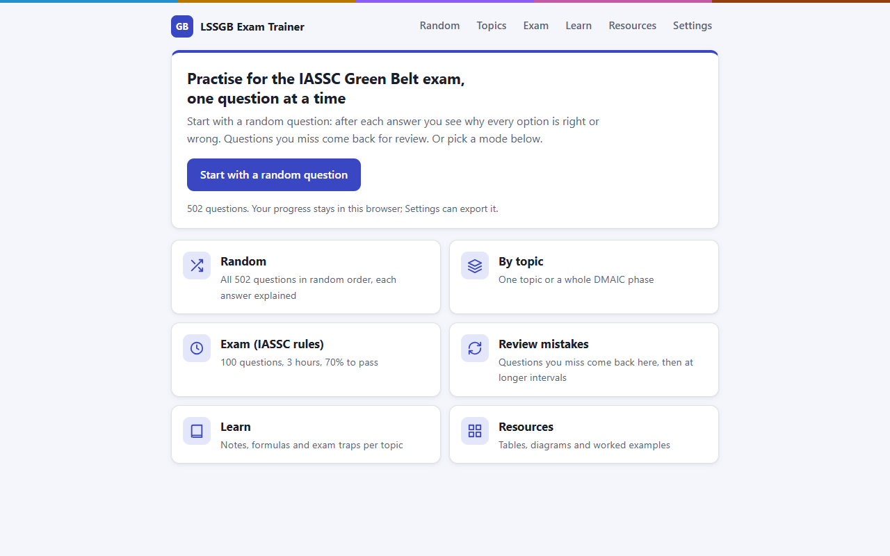
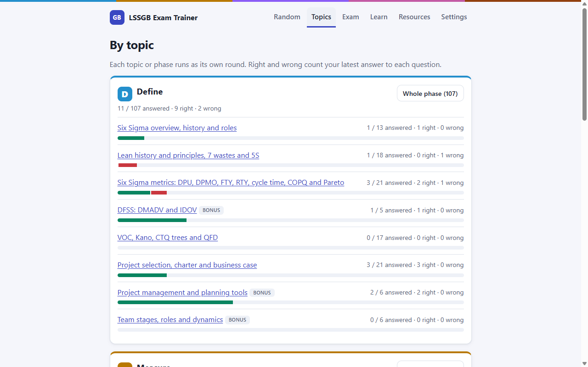
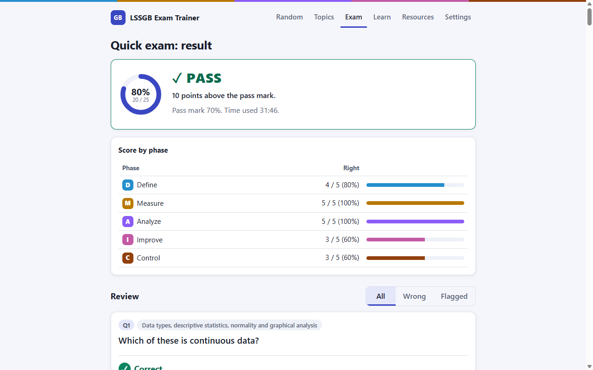
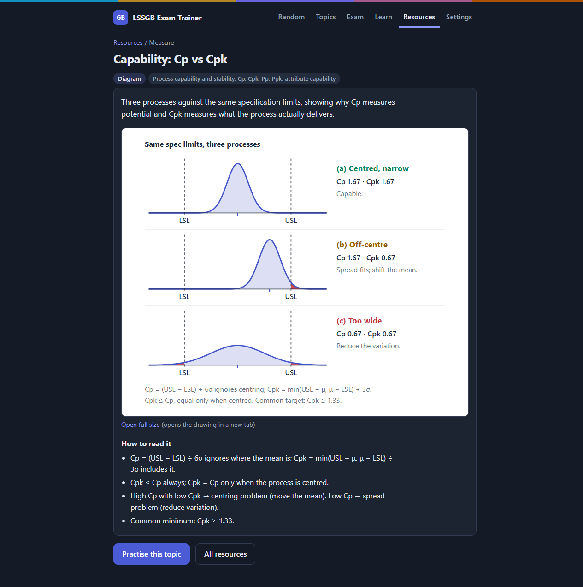

# LSSGB Exam Trainer

Practise for the IASSC Lean Six Sigma Green Belt exam with 502 fact-checked multiple-choice questions, each option explained.

**[Open the app](https://themathub.github.io/lssgb-exam-trainer/)** · [Learner guide](docs/USER_GUIDE.md)

## What you can do

- **Random:** work through all questions in random order, as a round you can leave and resume.
- **By topic:** run a round on one topic or a whole DMAIC phase; the list shows your score per topic.
- **Confirm:** in both modes you pick an answer, press Confirm, and see why each of the four options is right or wrong.
- **Review mistakes:** questions you miss come back the same day, then after 1, 3, 7, 14 and 30 days.
- **Exam:** a timed mock under IASSC rules, plus a 25-question, 45-minute quick exam.
- **Learn:** notes, formulas, exam traps and terms for each of the 27 topics, with a search across notes and questions.
- **Resources:** 54 references made from scratch: 24 diagrams, 12 worked examples, 10 cheat sheets and 8 tables.

## Exam facts

- The IASSC Green Belt exam has 100 questions, 3 hours and a 70% pass mark, with about 20 questions per DMAIC phase.
- On the IASSC exam, Improve covers correlation and regression only.
- Design of Experiments (DOE) and five other course topics appear here as bonus topics: you can practise them, and the mock exams leave them out.

## Use it

- **Online:** open <https://themathub.github.io/lssgb-exam-trainer/>.
- **From disk:** download or clone the repo and double-click `index.html`. You need no install, server or internet connection.
- **Local server:** run `python -m http.server 8000` in the repo folder, then open <http://localhost:8000>.

## Your progress

Your progress stays in your own browser (localStorage); nothing goes to a server. Each colleague who opens the link gets separate progress. To move yours to another device or browser, use Settings → Export progress, then Import progress on the other side.

## Screenshots

## Accuracy and sources

An independent reviewer checked every question against its source. Each question shows its source after you answer:

- "Lesson x.y" points to the lesson numbering of the Green Belt course the author took.
- "Web:" names a public source.
- "BoK" points to the IASSC Body of Knowledge.

Found an error? Open a [Question error issue](https://github.com/TheMattHub/lssgb-exam-trainer/issues/new?template=question-error.yml) with the question id (shown under the explanation, e.g. M2-007) and your source.

## Contribute

Fixes and new questions are welcome. [CONTRIBUTING.md](CONTRIBUTING.md) explains the data format and the content rules. Run `node tools/validate.mjs` before you open a pull request.

## Disclaimer

LSSGB Exam Trainer is an independent study aid, not affiliated with or endorsed by IASSC. The questions are original practice items, not real exam questions.

## License

Code: MIT ([LICENSE](LICENSE)). Content in `data/` and `assets/`: CC BY 4.0 ([LICENSE-CONTENT.md](LICENSE-CONTENT.md)). Copyright 2026 Matteo Brunetti.
