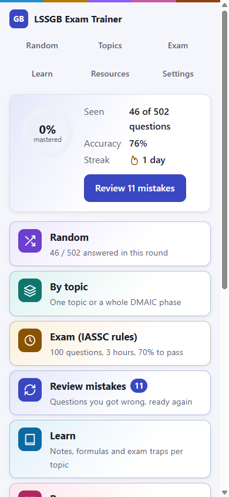
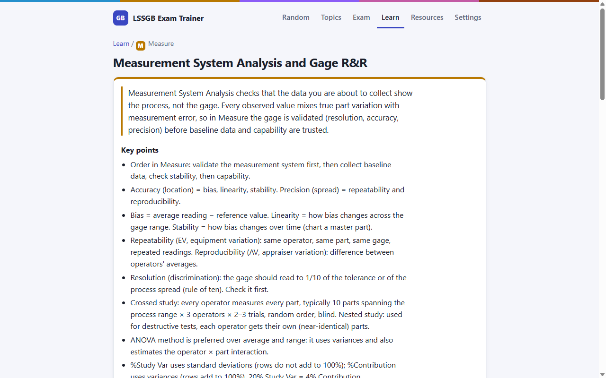
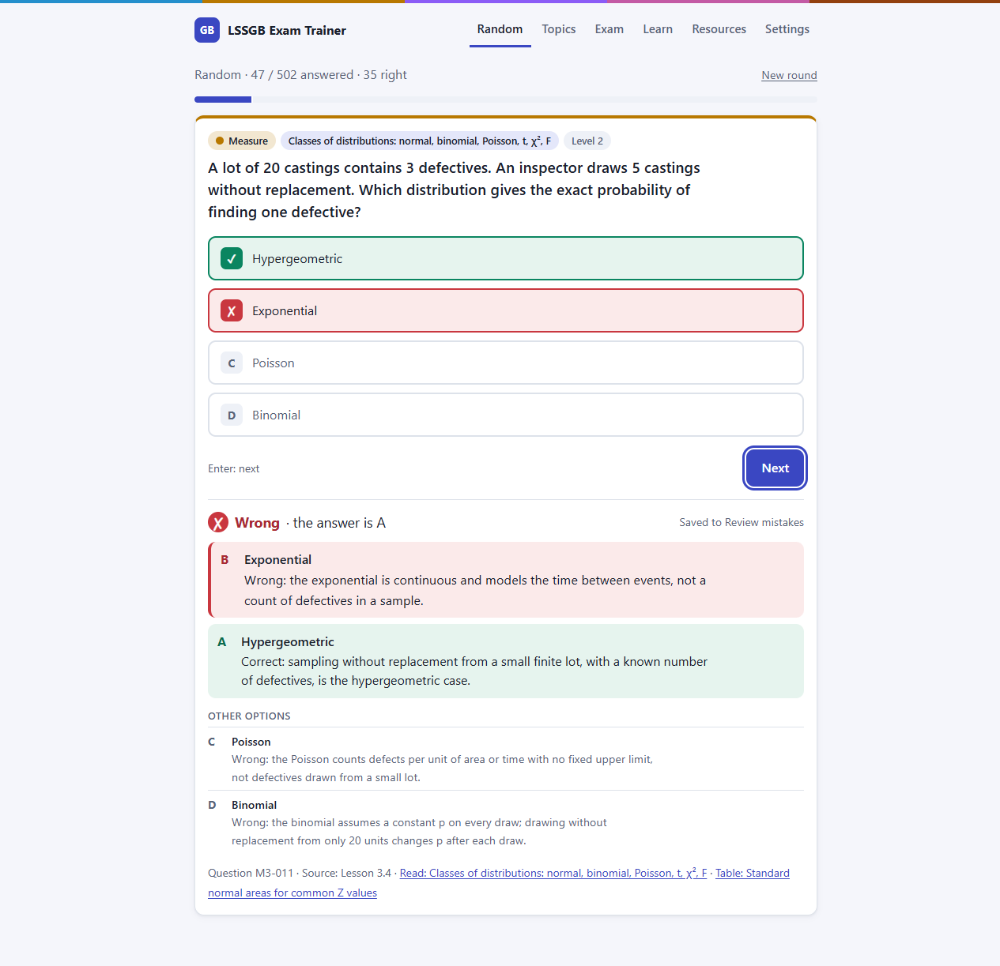

# Learner guide

This guide takes you from your first visit to exam day with LSSGB Exam Trainer. Read [First visit](#first-visit) once, then follow the [study plan](#a-study-plan-for-2-to-4-weeks). [Reading the feedback](#reading-the-feedback) and [How Review mistakes works](#how-review-mistakes-works) explain what the app shows you. [Exam mode tips](#exam-mode-tips), [Moving your progress](#moving-your-progress), [FAQ](#faq) and the [glossary](#glossary) come last.

Open the app at <https://themathub.github.io/lssgb-exam-trainer/>. It runs in any current browser, on a computer or a phone.

## First visit

1. Open the app. You should see a welcome card with the button **Start with a random question**, and six tiles: Random, By topic, Exam (IASSC rules), Review mistakes, Learn and Resources.
2. Press **Start with a random question**. You should see one question, four options marked A to D and a **Confirm** button.
3. Pick an option. Click it, or press a key from 1 to 4 or A to D. You can change your pick until you confirm.
4. Press **Confirm**, or Enter. You should see whether you were right and why each option is right or wrong.
5. Press **Next**, or Enter again, for the next question.
6. Go back to Home (the app name, top left). The welcome card has become a progress card: questions seen, accuracy and streak (days in a row with at least one answer).

Your progress saves itself in this browser after every answer. You need no account.

## A study plan for 2 to 4 weeks

The plan moves from narrow to broad: one phase at a time, then everything mixed, then timed exams. A [phase](#g-phase) is one of the five DMAIC steps (Define, Measure, Analyze, Improve, Control). Stretch each stage if you have four weeks; compress it if you have two.

**Every day, first:** open Review mistakes and clear the questions that are [due](#g-due). It takes 5 to 15 minutes.

| Stage | Weeks (of 4) | What to do |
| --- | --- | --- |
| 1. Phases | 1 and 2 | Topics → **Whole phase** for Define, then Measure, Analyze, Improve and Control. One phase every two or three days. |
| 2. Mixed | 3 | Random [rounds](#g-round). Aim to see every question once. |
| 3. Quick exams | 3 | Exam → **Start quick exam** every other day: 25 questions in 45 minutes. |
| 4. Full exams | 4 | Two or three full exams (100 questions, 3 hours), at least a day apart. |

After every miss, read the explanation, then open the linked Learn page or resource. The notes explain the idea behind the question, so the next question on it comes easier.

[Bonus topics](#g-bonus) (marked BONUS in the topic list) are outside the IASSC Green Belt syllabus. Practise them only if your course covered them.

## Reading the feedback

After you confirm, the app shows:

- **Right** or **Wrong**, and the letter of the correct answer.
- Your pick and the correct option, each with its reason. Every reason starts with "Correct:" or "Wrong:".
- **Other options**: why the remaining two are wrong. A wrong option's reason names the idea it confuses, which is often the trap you will meet on the exam.
- **Source**: where the fact comes from. "Lesson x.y" is the lesson numbering of the Green Belt course the author took; "Web:" names a public source; "BoK" is the IASSC [Body of Knowledge](#g-bok), the exam syllabus.
- Links to the topic's Learn page and, where one exists, a worked example or diagram.

A wrong answer also shows "Saved to Review mistakes".

## How Review mistakes works

Review mistakes uses a Leitner schedule: each question you have missed sits in a [box](#g-box), and the box decides when you see it again.

- A wrong answer puts the question in box 0. It is due again at once, the same day.
- A right answer moves it up one box. It is due again after 1, 3, 7, 14 and then 30 days.
- A wrong answer in any box sends it back to box 0.
- A question is [mastered](#g-mastered) from box 3, after three right answers in a row.

A due date counts from the start of the day, so "after 1 day" means any time tomorrow. Answers in Random, By topic and Exam mode move questions between boxes too. The Home tile shows how many questions are due.

## Exam mode tips

Exam mode follows the IASSC rules: 100 questions, 3 hours, 70% to pass, about 20 questions per phase, and no explanations until you submit.

- Sit a full exam in one go, without notes, as you would on the day.
- Pace yourself at under 2 minutes a question. The clock at the top counts down.
- Press **Flag** (or F) on a question you want to revisit. The grid of question numbers shows flagged and unanswered ones.
- Answer every question before you submit. An unanswered question counts as wrong.
- After you submit, filter the review by **Wrong** and **Flagged**. Your wrong answers also go to Review mistakes.

If you refresh or close the tab, the exam resumes with the same clock.

## Moving your progress

Your progress lives in the browser you use, so a second device starts empty. To move it:

1. On the old device, open **Settings** and press **Export progress**. You should get a file named like `lssgb-progress-2026-10-27.json`.
2. Copy the file to the new device, for example by e-mail or a shared folder.
3. On the new device, open **Settings**, press **Import progress** and choose the file.
4. Confirm **Replace your progress?**. You should see "Progress imported."

Import replaces the progress on the new device; it does not merge the two.

## FAQ

| What happens | Likely cause | Fix |
| --- | --- | --- |
| My progress has gone. | You used a private window, or cleared site data or browser history. | Use a normal window. Export your progress now and then as a backup. |
| A banner says the browser blocks storage. | Private mode or a blocked-cookies setting. | Progress lasts only until you close the tab. Allow site data, or export before you close. |
| A colleague sees none of my progress. | Each browser keeps its own progress. | Share the link; each person keeps a separate record. Send an export file only if they should continue from your progress. |
| I think a question is wrong. | The answer key or explanation may have an error. | Open a [Question error issue](https://github.com/TheMattHub/lssgb-exam-trainer/issues/new?template=question-error.yml) with the question id (shown under the explanation, e.g. M2-007) and your source. |

## Glossary

| Term | Meaning |
| --- | --- |
| Box | A step in the Leitner schedule, from 0 (just missed) to 5 (due every 30 days). |
| BoK | The IASSC Lean Six Sigma Green Belt Body of Knowledge, the exam syllabus. |
| Bonus topic | A course topic outside the BoK. You can practise it; exams leave it out. |
| Due | Ready for review today. |
| Mastered | In box 3 or higher: right three times in a row. |
| Phase | One of the five DMAIC steps: Define, Measure, Analyze, Improve, Control. |
| Round | One pass through a set of questions (all, one topic or one phase). The app saves it, so you can stop and resume. |
